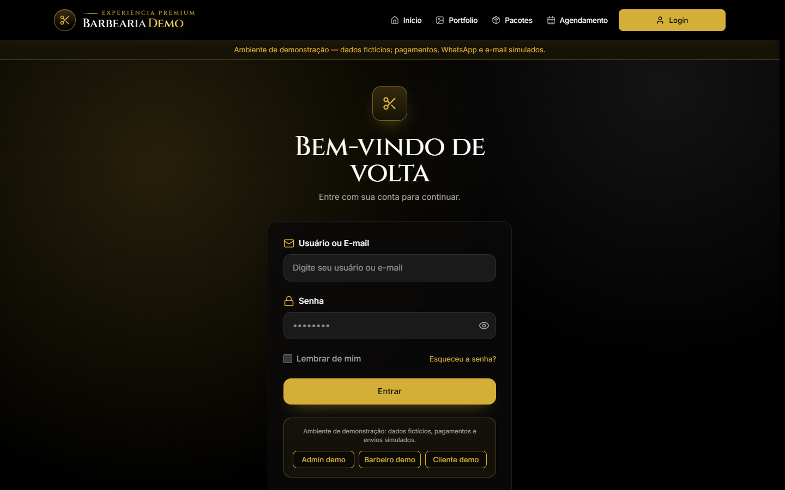
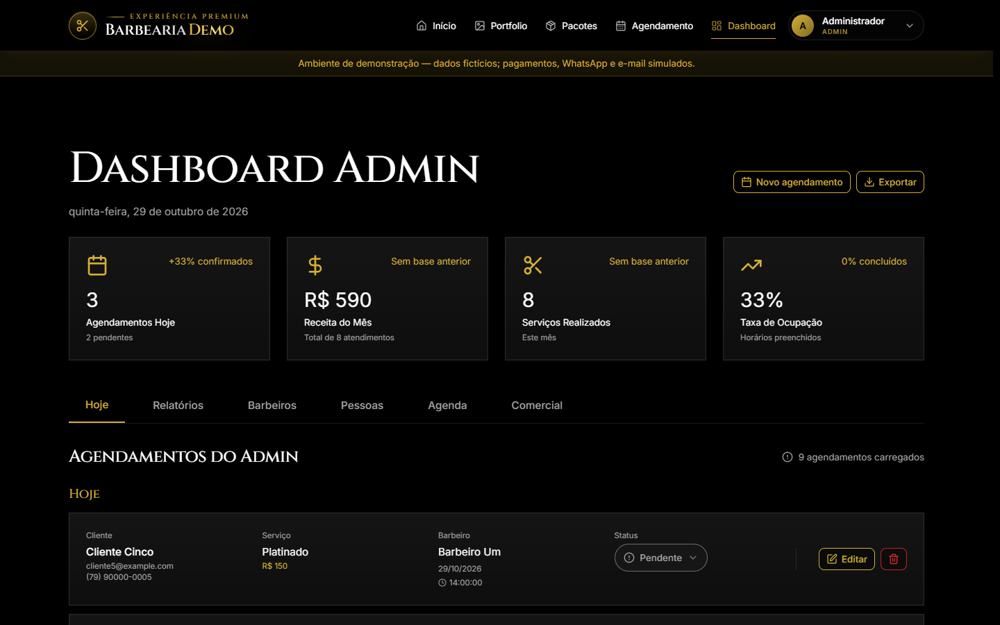
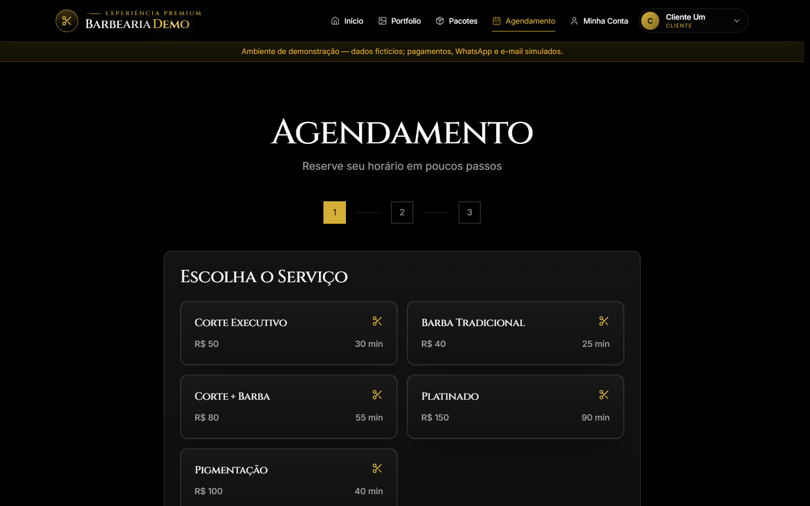

# Barbearia Demo: plataforma de agendamento e gestão

Plataforma web (SaaS) que substitui a agenda de papel de uma barbearia: agendamento online, painéis de administrador, barbeiro e cliente, controle de pacotes de sessões, faturamento e pagamento.

> Este projeto é baseado em um sistema real, em produção com um cliente. Nomes, dados e integrações foram anonimizados e substituídos por dados fictícios para este repositório de portfólio.

**🔗 Demo online:** https://barbearia-demo-99p1.onrender.com
*(a primeira visita pode levar cerca de 1 minuto, porque o serviço gratuito hiberna quando fica sem acesso)*

## Capturas de tela

| Início | Login (modo demo) |
| :---: | :---: |
|  |  |

| Dashboard do administrador | Agenda do barbeiro |
| :---: | :---: |
|  |  |

<p align="center">
  
</p>

---

## O problema

A barbearia usava agenda de papel, lista de espera e pacotes de sessões anotados à mão. Isso causava:

- **conflito de horários** entre barbeiros (horários esquecidos ou marcados duas vezes);
- **falta de controle dos pacotes** comprados pelo cliente (quando consumir e quando devolver uma sessão);
- **nenhuma operação remota**: o cliente não conseguia agendar sozinho, e o administrador e os barbeiros não acompanhavam a agenda à distância.

## A solução

Uma aplicação web em que o cliente agenda online, o administrador aprova e acompanha, e o barbeiro vê a própria agenda e conclui os atendimentos. As regras de negócio ficam no backend, para garantir consistência.

## Funcionalidades

- Agendamento online público (sem login) e cadastro do cliente
- Painéis separados para administrador, barbeiro e cliente, com controle de acesso por perfil (RBAC)
- Bloqueio de conflito de horário no banco, por barbeiro e faixa de horário
- Pacotes de sessões: consumo ao concluir o atendimento, devolução ao reabrir e expiração automática
- Fluxo de status do agendamento: pendente, confirmado, em atendimento, concluído e cancelado
- Pagamento online via Mercado Pago (checkout hospedado; simulado no modo demo)
- Fechamento de atendimento com registro de pagamento em dinheiro, PIX ou pacote
- Faturamento de uso e assinatura SaaS por plano
- Notificações por WhatsApp e e-mail (desativadas no modo demo)
- Autenticação com JWT e renovação automática (refresh) no frontend
- Dashboard com relatórios em PDF, portfólio, horários, bloqueios e gestão de usuários

## Stack e por quê

| Camada | Tecnologia | Motivo |
|---|---|---|
| Frontend | React 18.3, TypeScript, Vite 6, Tailwind CSS 4, React Router 7 | Interface componentizada, tipada e com build rápido |
| Backend | Python 3.12, Django 6.0, Django REST Framework 3.17 | Autenticação, ORM, migrations e admin prontos, o que acelera as regras de negócio |
| Autenticação | SimpleJWT 5.5 | Tokens de acesso e refresh |
| Banco | SQLite (desenvolvimento e demo), PostgreSQL (produção) | Simples para rodar localmente, robusto em produção |
| Integrações | WhatsApp Cloud API, SMTP, Mercado Pago | Notificações e pagamento |
| Deploy | Render + WhiteNoise + Gunicorn | O build do React é servido pelo Django, em um único serviço, sem Docker |

## Arquitetura

- O **frontend (SPA em React)** é compilado pelo Vite e servido pelo próprio Django. O `urls.py` roteia `/api/*` para as apps do backend e devolve o `index.html` para as demais rotas. Isso evita um segundo serviço e problemas de CORS em produção.
- O **backend** é dividido em apps do Django. As regras críticas (agendamento, pacotes e expiração) ficam em `api/services.py`, `api/package_subscriptions.py` e nos serializers, e não espalhadas nas views.
- Não há templates do Django: toda a interface é o React.

```text
Navegador
  └─ Django (Gunicorn)
       ├─ /api/*  -> REST Framework -> apps (api, accounts, barbers, billing, contacts, services)
       ├─ /healthz -> ping sem banco
       └─ /*      -> static/spa/index.html (build do Vite)
```

Apps do backend:

- `api`: agendamentos, disponibilidade, horários, bloqueios, pacotes, portfólio e sincronização.
- `accounts`: usuário customizado (papéis admin/barbeiro/cliente) e autenticação.
- `barbers`: perfil e disponibilidade dos barbeiros.
- `billing`: faturas, custos de uso, assinatura SaaS, pagamentos e notificações.
- `contacts`: mensagens do formulário público.
- `services`: catálogo de serviços e preços.
- `core`: settings, rotas, exceções, health check e entrega da SPA.

## Decisões técnicas

1. **Conflito de horário resolvido no banco.** A constraint `unique_active_slot_per_barber` (migration `0005`) impede dois agendamentos no mesmo barbeiro/data/horário. Se só a aplicação validasse, duas requisições simultâneas poderiam passar.
2. **Regras de pacotes na camada de serviço.** O consumo, a devolução e a expiração de sessões ficam centralizados em `api/services.py`, `api/package_subscriptions.py` e serializers, para não haver regra duplicada.
3. **JWT com renovação automática.** O front renova o token de acesso sem pedir novo login.
4. **Modo demo.** Com `DEMO_MODE=true`, o sistema usa SQLite efêmero, desliga as integrações externas, simula o pagamento, mostra um aviso na interface, cria botões de login demo e carrega dados fictícios no arranque.

## Como rodar localmente

Pré-requisitos: Python 3.12 e Node.js 20 ou 22 (o projeto foi testado com Node 22+).

```bash
# 1. Backend
cd backend
python -m venv .venv
source .venv/bin/activate        # Windows: .venv\Scripts\Activate.ps1
pip install -r requirements.txt
cp .env.example .env             # Windows: Copy-Item .env.example .env
# edite .env: defina SECRET_KEY e DEMO_MODE=True
python manage.py migrate
python manage.py seed_demo       # cria os dados fictícios (exige DEMO_MODE=True)

# 2. Frontend
cd ..
npm ci
npm run build                    # gera backend/static/spa

# 3. Subir o servidor
cd backend
python manage.py runserver
```

Abra `http://localhost:8000`. Para desenvolver a interface com hot reload, rode `npm run dev` (Vite em `http://localhost:5173`) com o backend em outra janela; o `.env.example` da raiz define `VITE_API_URL`.

## Credenciais de demonstração

⚠️ Somente para demonstração, com dados fictícios. A senha padrão é `demo12345`, configurável por `DEMO_SEED_PASSWORD` (e `DEMO_ADMIN_PASSWORD` para o admin).

| Perfil | E-mail | Senha |
|---|---|---|
| Administrador | admin@example.com | `demo12345` |
| Barbeiro | barbeiro1@example.com / barbeiro2@example.com | `demo12345` |
| Cliente | cliente1@example.com até cliente5@example.com | `demo12345` |

No modo demo, a tela de login tem botões para entrar direto como administrador, barbeiro ou cliente.

## Variáveis de ambiente

Backend (`backend/.env.example`):

| Variável | Para que serve |
|---|---|
| `SECRET_KEY` | Chave secreta do Django (obrigatória) |
| `DEBUG` | Modo de depuração |
| `DATABASE_URL` | Banco de dados; vazio usa SQLite |
| `DATABASE_SSL_REQUIRE` | Força SSL na conexão PostgreSQL |
| `ALLOWED_HOSTS` | Hosts aceitos pelo Django |
| `DJANGO_ENV` | `dev` ou `prod` (settings e defaults de segurança) |
| `DEMO_MODE` | Liga o modo demonstração |
| `DEMO_DB_PATH` | Caminho do SQLite usado na demo |
| `DEMO_SEED_PASSWORD` | Senha das contas fictícias |
| `DEMO_ADMIN_PASSWORD` | Senha do administrador fictício |
| `CORS_ALLOWED_ORIGINS` | Origens permitidas para o frontend separado |
| `CSRF_TRUSTED_ORIGINS` | Origens confiáveis para formulários/admin |
| `SECURE_SSL_REDIRECT`, `SESSION_COOKIE_SECURE`, `CSRF_COOKIE_SECURE` | Controles de HTTPS e cookies |
| `SECURE_HSTS_SECONDS`, `SECURE_HSTS_INCLUDE_SUBDOMAINS`, `SECURE_HSTS_PRELOAD` | HSTS |
| `DEFAULT_FROM_EMAIL` | Remetente dos e-mails |
| `FRONTEND_URL` | URL usada nos links de retorno do pagamento |
| `BACKEND_PUBLIC_URL` | URL pública usada no webhook do Mercado Pago |
| `MERCADO_PAGO_ACCESS_TOKEN` | Token do checkout (desligado na demo) |
| `MERCADO_PAGO_WEBHOOK_SECRET` | Segredo para validar a assinatura do webhook |
| `WHATSAPP_ACCESS_TOKEN`, `WHATSAPP_PHONE_NUMBER_ID`, `WHATSAPP_VERIFY_TOKEN` | Integração com a WhatsApp Cloud API |
| `API_RATE_LIMIT_ANON`, `API_RATE_LIMIT_USER` | Throttling global por hora |
| `API_RATE_LIMIT_CONTACT`, `API_RATE_LIMIT_CHECKOUT` | Throttling por endpoint |
| `DJANGO_LOG_LEVEL` | Nível de log |

Frontend (`.env.example` da raiz):

| Variável | Para que serve |
|---|---|
| `VITE_API_URL` | URL da API quando o frontend roda separado; vazio usa a mesma origem |

## Testes

```bash
cd backend
python manage.py test            # 20 testes
cd ..
npm test                         # 4 testes (Vitest)
npm run check:imports            # valida imports da SPA
npm run build                    # garante que a SPA compila
```

Cobertura atual:

- **Backend (20 testes):** regras de pacotes ilimitados, conflito de horário no mesmo barbeiro, idempotência do `seed_demo`, recusa do seed fora do modo demo, login demo, `/healthz`, permissões das mensagens de contato, checkout (login, dono, simulação e ausência de token) e webhook do Mercado Pago (assinatura HMAC inválida, segredo ausente e confirmação válida).
- **Frontend (4 testes):** copy de pacotes via Vitest.
- **Não coberto:** concorrência real do constraint de horário, testes de carga, integrações externas reais e testes end-to-end de navegador.

## Deploy

A demo é publicada no Render com um `render.yaml` (Blueprint) em um único serviço gratuito, sem Docker e sem PostgreSQL: o `start.sh` recria o SQLite e roda o `seed_demo` a cada arranque. Passo a passo em [`docs/GUIA_DEPLOY_RENDER.md`](docs/GUIA_DEPLOY_RENDER.md).

Para monitorar o serviço, configure um ping HTTP em `https://barbearia-demo-99p1.onrender.com/healthz` a cada 5 minutos; o endpoint responde `{"ok": true, "demo": true}` sem consultar o banco.

Outros guias: [`docs/GUIA_TESTES.md`](docs/GUIA_TESTES.md) e [`docs/SINCRONIZACAO_E_FATURAMENTO.md`](docs/SINCRONIZACAO_E_FATURAMENTO.md). Não há workflow de CI (GitHub Actions) configurado.

## Estrutura de pastas

```text
backend/
  api/            agendamentos, disponibilidade, pacotes, portfólio, sync e seed demo
  accounts/       usuário customizado, autenticação e auditoria de senhas
  barbers/        perfis e disponibilidade dos barbeiros
  billing/        faturas, custos, assinatura SaaS, pagamentos e notificações
  contacts/       mensagens do formulário público
  services/       catálogo de serviços e preços
  core/           settings, urls, healthz, exceções e entrega da SPA
  static/spa/     build do Vite (gerado, fora do Git)
  build.sh        build do Render (npm + collectstatic)
  start.sh        migrate, reset/seed da demo e Gunicorn
src/
  app/
    components/   componentes de UI e painéis
    context/      autenticação JWT e estado do usuário
    pages/        telas da SPA
  hooks/          sincronização de agendamentos
  lib/            utilitários, rotas de autenticação e PDF
  services/       cliente HTTP
  styles/         Tailwind e tema
docs/             deploy, testes, faturamento e atribuições
scripts/          verificação de imports
render.yaml       Blueprint da demo no Render
```

## Limitações e próximos passos

- O token JWT fica no `localStorage` do navegador. Uma alternativa mais segura seria cookie `httpOnly`.
- Não há Content-Security-Policy configurada.
- Testes automatizados cobrem as regras listadas acima; faltam testes de concorrência para o constraint de horário e testes de carga.
- Integrações externas (WhatsApp, e-mail e Mercado Pago) ficam desligadas no modo demo e só foram usadas no sistema real.
- Na demo, o SQLite é efêmero: reinícios apagam alterações feitas na sessão. O plano gratuito do Render hiberna e a primeira visita pode demorar cerca de 1 minuto.
- Uploads de mídia usam o disco local do serviço; sem disco persistente, arquivos somem a cada deploy.
- O projeto é single-tenant e não possui CI configurado.
- Próximos passos: testes de concorrência, CSP e cookies `httpOnly`, storage externo para mídia e pipeline de CI com os testes atuais.

## Autor

**Jimy Kauã dos Santos Silva**, desenvolvedor backend em formação (Análise e Desenvolvimento de Sistemas, UNIT).

[GitHub](https://github.com/Jimykw) · [LinkedIn](https://linkedin.com/in/jimydev/) · kwjimy@gmail.com
